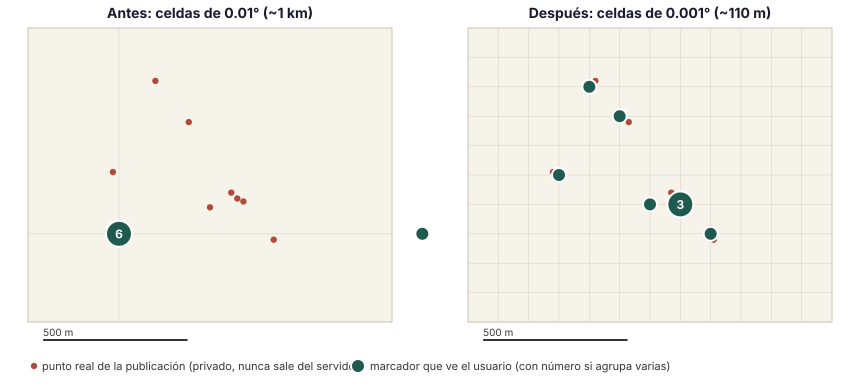

# Mapa de publicaciones: puntos más precisos — 20-oct-2026

Para Alejandro y Pedro. Pedro reportó, con captura desde su iPhone en `/mapa`
(zona San Bernardino Tlaxcalancingo), que el mapa no refleja dónde está cada
publicación: todo lo de la zona de la Anáhuac aparece en **un solo número «12»**,
el grupo «2» no está donde esa gente publicó, y el usuario no obtiene la guía
visual que el mapa promete.

Rama: `fix/mapa-puntos-publicaciones-20261020`. Estado al escribir: **plan +
implementación en curso**; la sección «Ejecución» de abajo se completa al cerrar.

---

## 1. Diagnóstico (por qué pasa)

La cadena real es: punto exacto → columna pública redondeada → RPC que agrupa por
celdas → API → cliente que reagrupa → marcador en MapKit.

1. **La columna pública `ubicacion_mapa` redondea a 2 decimales.** Migración
   `20260930220000_mapa_publicaciones_aproximadas.sql`: `round(lat, 2)` y
   `round(lng, 2)`. Una celda de 0.01° mide **~1.1 km de norte a sur y ~1.05 km
   de este a oeste** en Puebla. Toda publicación dentro de ese kilómetro cae en
   el **mismo nodo** de la rejilla (no en su centro ni en la publicación: en la
   esquina redondeada). Por eso «12»: son todas las publicaciones del kilómetro
   de la Anáhuac, de 10 vendedores distintos.
2. **El RPC `search_map_publications_v2` cuenta por celdas de 0.01° y el cliente
   no puede bajar de ahí.** `x = round(lng·100)`, `y = round(lat·100)`; el
   cliente (`lib/geo/map-coverage.ts`) agrupa celdas en potencias de 2 del paso,
   pero el paso mínimo es **1 celda = 1 km**. Al acercar el zoom no aparece nada
   más fino: la captura ya está en el nivel más detallado que existe.
3. **El marcador se pinta en el promedio de los miembros.** Con una sola celda,
   el promedio es el propio nodo de la rejilla, que puede estar a **hasta
   ~760 m** de cualquiera de sus publicaciones. Por eso el «2» «ni siquiera está
   ahí».
4. No hay error de orden lat/lng ni de captura: `/vender` guarda el punto exacto
   que el vendedor elige (`ubicacion_geo`, privado). El problema es solo de
   **resolución de la proyección pública**.

Antecedente: la precisión de ~1 km la fijó la decisión S10 del 30-sep-2026
(autorizada por Javier) como medida de privacidad: un vendedor publica desde su
casa y el mapa no debe revelar el domicilio. Esa intención se conserva; lo que
cambia es el tamaño de la celda.

## 2. Lo que resuelven otros (resumen de la investigación)

Investigación del 20-oct-2026 sobre fuentes abiertas (documentación oficial y
código leído en GitHub). Lo relevante para VICINO:

| Producto | Qué ve el comprador | Precisión |
|----------|---------------------|-----------|
| Airbnb | Círculo sombreado, nunca pin exacto; el punto desplazado es **estable** y distinto por anuncio | ~150–450 m |
| OLX / Otodom | Círculo de radio variable si el vendedor eligió «zona aproximada» | 1–6 km |
| Facebook Marketplace | Círculo «seller location»; en 2019 el JSON filtraba la coordenada exacta (parche posterior) | no publicado |
| Wallapop / Nextdoor / Vinted | Sin pin: orden por distancia, barrio o ciudad | barrio |
| Mercado Libre | Ciudad del vendedor (productos) | ciudad |

- **Nadie agrupa vendedores distintos en una celda fija.** El patrón dominante es
  un punto público propio por anuncio o vendedor, calculado **una sola vez** y
  persistido (si cambia entre consultas se promedia hasta recuperar la casa).
- **Agrupado por zoom.** Supercluster (Mapbox), Leaflet.markercluster y los
  tileservers con PostGIS (`ST_SnapToGrid` sobre una rejilla en metros por nivel
  de zoom) abren los grupos al acercarse y pasan a puntos individuales a partir
  de ~z15. Los puntos con la **misma** coordenada nunca se separan por zoom: Leaflet
  los abre «en abanico» (spiderfy); MapKit JS no tiene esa función y habría que
  emularla con `anchorOffset`.
- **Riesgos documentados.** El estudio TechScience 2018 sobre Airbnb re-identificó
  al 94 % de los anfitriones únicos cruzando el punto desplazado con un padrón
  público: ningún desplazamiento estático es anonimato total. Un desplazamiento
  determinista sin secreto de servidor es reversible (el id del anuncio es
  público). Una celda con un solo vendedor acota su casa a esa celda.

Lo que VICINO ya hace bien respecto a la industria: el punto exacto nunca sale
del servidor, el cliente recibe solo celdas, y los filtros por área y distancia
se calculan sobre la proyección pública (nada de búsqueda binaria con bounding
boxes). Lo que faltaba es resolución: la celda de 1 km convierte toda una
colonia en un número.

## 3. Decisión de diseño

**Proyección pública v2: celdas de 0.001° (~110 m) en vez de 0.01° (~1 km).**

- Se añade una columna generada `ubicacion_publica` = punto exacto redondeado a
  **3 decimales**. Sigue siendo lossy e irreversible: el punto público nunca está
  a más de ~78 m del real y no identifica una casa en una manzana típica.
- Se añade `search_map_publications_v3(jsonb)`: el mismo contrato que v2
  (overview / cells / listings / check, revisión, cursores, 50 km, bloqueos,
  filtros) pero sobre la nueva columna y con la rejilla en **milésimas de grado**.
  `projection_version: 2` en la respuesta.
- `v1`, `v2` y `ubicacion_mapa` **no se tocan**: la ruta `/api/publications/map/coverage`
  llama a v3 **solo si `VICINO_MAPA_RPC=v3`** está en el entorno (falla cerrado) y,
  si la base aún no tiene la función, **cae a v2** y avisa a Sentry una vez. Eso
  hace el despliegue seguro en cualquier orden, convierte la precisión en una
  decisión explícita y deja un camino de vuelta sin tocar la base.
- El cliente lee `projection_version` para saber en qué unidades vienen las
  celdas (100 o 1000 por grado); así una respuesta de v2 sigue pintándose bien.
- Mismos topes: 300 marcadores, refinar bajo 180, paginación de celdas de 300,
  2 MiB / 10 000 celdas en memoria.

**Por qué redondeo y no desplazamiento aleatorio («jitter»).** Un desplazamiento
determinista por anuncio se puede deshacer si no depende de un secreto (el id es
público), y uno aleatorio por consulta se promedia con varias consultas hasta
recuperar la casa (es la razón escrita en `product-map-zone.ts`). El redondeo a
una celda es la única promesa que no se puede revertir con más datos.

**Lo que cambia para el usuario.** En la zona de la captura, las 12
publicaciones del kilómetro se reparten en sus manzanas (cada ~110 m un punto o
un número pequeño). Dos vendedores a menos de ~100 m siguen compartiendo un
número: es verdad y se muestra como tal. Al tocar un número se abre la lista
como hoy.

## 4. Plan de trabajo

| # | Paso | Dónde | Verificación |
|---|------|-------|--------------|
| 1 | Migración: columna `ubicacion_publica` (3 decimales, generada, sin SELECT para clientes), índice GiST parcial, `search_map_publications_v3`, permisos solo `authenticated`/`service_role`, comprobaciones al final | `supabase/migrations/20261020150000_mapa_puntos_precisos_v3.sql` | Prueba SQL en PGlite (`scripts/test-s13-map-sql.ts`) + aplicación real en **staging** (PostGIS 3.3) |
| 2 | Contrato compartido: `projection_version` 1 ó 2, rangos de cursores/celdas en milésimas, constantes de unidades | `packages/shared/src/validators/publications-map.ts` | Pruebas existentes S10/S11 + nuevas |
| 3 | Cliente: unidades por versión de proyección en `clusterMapLayer`/`publicZoneBounds`; `map-explorer` las pasa | `apps/web/lib/geo/map-coverage.ts`, `app/(marketplace)/mapa/map-explorer.tsx` | `scripts/test-s12-map-clusters.ts` (actualizada), `test-s11-map-cache.ts`, `test-s11-map-browser.ts` |
| 4 | API: v3 con caída a v2 si no existe | `apps/web/app/api/publications/map/coverage/route.ts` | `scripts/test-s11-map-api.ts` + caso nuevo |
| 5 | Calidad: `pnpm type-check`, `pnpm lint`, `pnpm build`, loop adversarial de CLAUDE.md, agentes de revisión | — | Salidas en este documento |
| 6 | Verificación visual: web local contra staging con fixtures de 3 vendedores en la misma colonia; antes/después | `scripts/staging/dev-contra-staging.mjs` | Capturas en el PDF |
| 7 | Entrega: commit, push, PR a `master`; **aplicar la migración en producción** (`node scripts/apply-migration.mjs ...`) y regenerar tipos (`node scripts/gen-types.mjs`) | — | La ruta cae a v2 mientras tanto, así que el orden no rompe nada |

Fuera de alcance, para decidir con Javier: (a) el minimapa de la ficha de producto
sigue mostrando la celda de ~1 km (`product-map-zone.ts`); (b) un marcador
distinto por vendedor dentro de la misma celda; (c) ubicación exacta opcional
para negocios con local (`seller_type = business`).

## 5. Ejecución (20/21-oct-2026)

### Qué cambió

| Archivo | Cambio |
|---------|--------|
| `supabase/migrations/20261020150000_mapa_puntos_precisos_v3.sql` | **Nueva.** Columna generada `ubicacion_publica` (3 decimales), índice GiST parcial, `search_map_publications_v3(jsonb)` (mismo contrato que v2, rejilla ×1000, `projection_version: 2`), permisos solo `authenticated`/`service_role`, bloque de verificación de privilegios y de funciones duplicadas. **Aplicada en producción el 21-oct-2026** (autorizó Pedro); ver «Producción» abajo. |
| `apps/web/app/api/publications/map/coverage/route.ts` | Con `VICINO_MAPA_RPC=v3` llama a v3; si la base responde `PGRST202` (función ausente) cae a v2 y avisa a Sentry una vez por proceso. Sin la variable (o con cualquier otro valor) usa v2: la proyección de 1 km sigue siendo la de siempre hasta que alguien la cambie a propósito. |
| `packages/shared/src/validators/publications-map.ts` | `projection_version` admite 1 ó 2; constantes `MAP_CELL_UNITS_V1/V2`; rangos de cursores y grupos válidos en las dos unidades. |
| `apps/web/lib/geo/map-coverage.ts` | `cellUnits(projection_version)`; `clusterMapLayer`/`publicZoneBounds` reciben las unidades; encuadre mínimo de 0.006° para que «Ver área» de una celda de 110 m sea legible. |
| `apps/web/app/(marketplace)/mapa/map-explorer.tsx` | Pasa las unidades de la respuesta al agrupado y al encuadre. Sin cambios visuales ni de copy. |
| `scripts/lib/database-type-overrides.mjs` | Al regenerar tipos, `ubicacion_publica` queda no escribible igual que `ubicacion_mapa` (opcional hasta aplicar la migración). |
| `apps/web/.env.example` | Documenta `VICINO_MAPA_RPC`. |
| Pruebas | Nueva `scripts/test-s13-map-sql.ts` (10 casos PGlite); `test-s12-map-clusters.ts` (9 casos, ambas proyecciones); `test-s11-map-api.ts` (+2: caída a v2 y variable de entorno); `test-s11-map-cache.ts` (fixture etiquetada como proyección 1); `scripts/staging/probar-mapa-v3.mjs` (8 casos en staging con PostGIS y PostgREST reales). |

Lo que **no** cambió: `ubicacion_mapa`, `search_map_publications_v1/v2`, el
formulario de publicar, el minimapa de la ficha de producto, los textos del
mapa («Ubicaciones aproximadas», «Punto: una publicación…»), los topes de 300
marcadores y la caché del cliente.

### Antes y después, a escala

 Ocho publicaciones de cinco
vendedores en la zona de Tlaxcalancingo (fixtures del staging con coordenadas
reales de la colonia). Izquierda: proyección de 0.01°, tres marcadores (6+1+1)
en nodos de la rejilla. Derecha: proyección de 0.001°, seis marcadores sobre
sus manzanas; los dos vendedores a menos de 60 m siguen compartiendo un «3».

### Verificación

- **PGlite (SQL aislado, con shims espaciales):** `test-s13-map-sql` 10/10,
  `test-s11-map-sql` 9/9, `test-s10-map-sql` 12/12.
- **Staging real** (`vicino-staging`, PostGIS 3.3, PostgREST): `probar-mapa-v3`
  8/8. La columna generada da `POINT(-98.206 19.041)` para la manzana y
  `POINT(-98.208 19.044)` para el vecino a 350 m; v2 los apila en una celda de 4;
  v3 devuelve la celda de la manzana con 3 publicaciones de 2 vendedores y la
  otra aparte; `GET products_services?select=ubicacion_publica` con sesión → 403;
  anon → 401; p50 122 ms / p95 277 ms la vista general por PostgREST.
- **Web local contra staging** (`/mapa?lat=19.0414&lng=-98.2063`, usuario de
  prueba): la respuesta de `/api/publications/map/coverage` trae
  `projection_version: 2` y 6 celdas para «8 publicaciones · 5 vendedores»;
  la lista accesible muestra «Ver zonas (6)» con «Zona 2 · 3 publicaciones».
  MapKit no se pudo pintar en local (sin claves de Apple en este entorno), así
  que la comprobación visual con teselas reales queda para el preview de Vercel
  o el teléfono de Pedro.
- **Cliente y contrato:** `test-s12-map-clusters` 9/9, `test-s11-map-cache`
  17/17, `test-s11-map-api` 10/10, `test-s10-map-api` 8/8,
  `test-s10-map-contract` 5/5, `test-s11-map-browser` 79/79 (Chromium
  controlado), `test-s12-map-markers` y `test-s12-map-markers-browser` en verde,
  `test-database-type-overrides` en verde.
- **Calidad:** `pnpm type-check`, `pnpm lint` y `pnpm build` (webpack, el mismo
  comando que corre Vercel) en verde.
- **Revisión adversarial interna (regla de CLAUDE.md), 2 iteraciones:** sin
  críticos. Un importante corregido: al regenerar tipos, `ubicacion_publica`
  habría quedado escribible en `Insert`/`Update`; ahora `database-type-overrides`
  la protege igual que `ubicacion_mapa` (con prueba). Revisado también: rangos de
  cursores/grupos en las dos unidades, `revision` y `query_key` distintos entre
  v2 y v3 (un cursor viejo cae como caduco → 409 → el cliente reinicia),
  encuadre de «Ver área» idéntico al anterior para respuestas v2, y que la
  columna nueva nace sin privilegios (verificado en staging por PostgREST).
  La auditoría de seguridad externa se resume más abajo; el agente revisor de
  código no pudo terminar por un límite de uso del modelo auxiliar.

### Producción (21-oct-2026)

Migración aplicada con `scripts/apply-migration.mjs` (ledger `20261020150000`).
Comprobado con consultas de solo lectura: v1, v2 y v3 existen una vez;
`ubicacion_publica` sin SELECT para `anon` ni `authenticated`; v3 ejecutable
solo con sesión; los dos índices presentes; las 56 publicaciones con punto
tienen proyección. En el catálogo real (51 publicaciones visibles de 38
vendedores): **12 celdas de 1 km → 38 celdas de 110 m**, y el grupo más grande
baja de **12 a 7** publicaciones. Tipos regenerados en el mismo PR. El mapa
sigue en ~1 km hasta que `VICINO_MAPA_RPC=v3` esté en Vercel (lo pone Pedro
cuando el PR esté desplegado).

### Cómo se despliega (y cómo se deshace)

La precisión nueva **falla cerrada**: ni el merge ni la migración la encienden.
Solo la variable `VICINO_MAPA_RPC=v3` en Vercel la activa (recomendación de la
auditoría de seguridad, abajo, para que la decisión de privacidad sea explícita).

1. Mergear la rama a `master` (Vercel despliega). El mapa sigue en ~1 km.
2. ~~Aplicar la migración en producción~~ **Hecho el 21-oct** (ver arriba).
3. ~~Regenerar tipos~~ **Hecho**, en el mismo PR.
4. **Encender:** `VICINO_MAPA_RPC=v3` en Vercel (producción) y redeploy, una
   vez que el deploy del PR ya se propagó (los bundles anteriores no aceptan
   `projection_version: 2` hasta recargar). Si la función no existiera aún, la
   ruta cae sola a v2 y lo avisa en Sentry. Si Preview comparte base, probar
   primero con la variable solo en Preview.
5. Deshacer: quitar la variable (o ponerla en `v2`). La base no se toca. Si se
   quiere retirar la función, `DROP FUNCTION public.search_map_publications_v3(jsonb)`
   en una migración.

### Auditoría de seguridad y privacidad (21-oct, agente revisor)

Veredicto: **sin críticos** en el cambio. Ninguna respuesta de v3 puede traer la
coordenada exacta, la dirección ni datos de perfil más allá del nombre público;
todos los predicados (área, radio, cobertura, revisión, cursores) operan sobre
la proyección; la columna nace sin privilegios; sin SQL dinámico. Hallazgos y
qué se hizo con cada uno:

| Nivel | Hallazgo | Estado |
|-------|----------|--------|
| ALTO | 110 m + nombre completo + `creador_id` para quien publica desde casa señala la manzana (1–5 viviendas en zonas poco densas); S10 fijó 1 km. | **Decisión de producto, no se activa sola.** La ruta falla cerrada (`VICINO_MAPA_RPC=v3` explícito). Alternativas en «Lo que queda por decidir». |
| ALTO (preexistente, fuera de este cambio) | Dos observaciones sobre funciones ya existentes del feed y del mapa, anteriores a este cambio. El detalle se entregó a Pedro por el canal privado (este repositorio es público). | **Pendiente para Pedro:** comprobar en staging antes de encender v3. |
| MEDIO | Sin la variable, aplicar la migración habría encendido 110 m al instante (y una errata en la variable seleccionaba v3). | **Corregido:** default v2; solo `v3` normalizado activa v3. |
| MEDIO | Un vendedor con varias publicaciones en celdas contiguas acota su posición a la franja entre ellas (irrelevante a 1 km, útil a 110 m). | Documentado; lo elimina el desplazamiento por vendedor (alternativa 1). |
| MEDIO | Transparencia: el aviso de privacidad dice «ciudad, colonia o zona»; la ficha de producto sigue en ~1 km; el formulario no avisa de la precisión del mapa. | Pendiente de producto/legal antes de encender v3. |
| BAJO | Cursores de listado mal formados daban 503 en vez de 409. | **Corregido** en v3 (22023). |
| BAJO | Cruzar la celda de 1 km (v1/v2) con la de 110 m reduce la incertidumbre en los bordes (~19 % de los casos). | Documentado; se resuelve al retirar v1/v2 cuando v3 sea definitiva. |
| BAJO | `ADD COLUMN … GENERATED … STORED` reescribe la tabla con bloqueo exclusivo. | Documentado en los pasos de despliegue. |

**Revisión de código (agente revisor, 21-oct):** sin críticos; cuatro
importantes atendidos (el interruptor fail-closed va en el mismo PR; nada de
detalle de debilidades en el repo público; el cuerpo de v3 se contrastó con la
definición de v2 instalada; v3 rechaza un `cell_id` en unidades de v2 en vez de
devolver una lista vacía). Sugerencias aplicadas: `units` obligatorio en el
agrupado del cliente (sin default silencioso), `preloadCoverage` no mezcla
proyecciones aunque coincida la revisión, excepción de cursores acotada a los
tres códigos de formato. Dos notas para después: con v3 hay casi una celda por
publicación, así que al crecer hacia miles de publicaciones en 50 km conviene
bajar el tope de celdas o subir el tamaño de página (hoy no se nota); y
encender `VICINO_MAPA_RPC=v3` solo cuando el deploy ya se propagó, porque un
bundle anterior al PR rechaza `projection_version: 2` hasta recargar.

### Lo que queda por decidir (Javier / Alejandro)

1. **Nivel de privacidad.** 110 m es más preciso que lo acordado en S10 (1 km).
   Alternativa más conservadora si se prefiere: desplazamiento determinista por
   vendedor en un anillo de 150–300 m con sal secreta (estilo Airbnb), que da un
   punto propio por vendedor pero no revela la manzana; cuesta un trigger y un
   secreto en la base. Otra opción: ubicación exacta opcional para negocios con
   local (`seller_type = business`).
2. **Minimapa de la ficha de producto** sigue en ~1 km (`product-map-zone.ts`);
   si el mapa muestra 110 m, conviene igualarlo o explicar la diferencia.
3. **Textos.** El copy sigue diciendo «Ubicaciones aproximadas»; se puede añadir
   «(unos 100 m)» si diseño lo aprueba.
4. **Varios vendedores en la misma celda de 110 m** siguen compartiendo un
   número (es cierto que están a menos de 100 m). Si se quiere un marcador por
   vendedor, hace falta «abanico» al tocar, que MapKit JS no trae de serie.

### No verificado

- Teselas reales de Apple Maps con la proyección nueva (sin claves en local).
- Teléfono físico (iPhone/Android) y gestos de pinza.
- Producción con `VICINO_MAPA_RPC=v3` encendido: la migración está aplicada y
  verificada, pero el mapa real con la proyección nueva solo se verá cuando el
  PR esté desplegado y Pedro ponga la variable.
